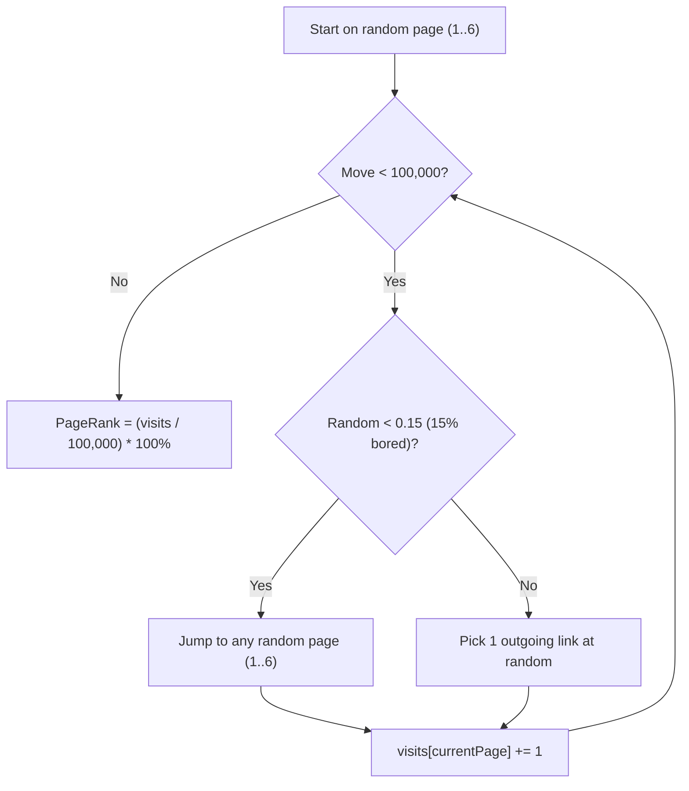

# Implementation Plan: Mini Google 1998

## Goal Description

Build a self-contained, single-file web application at [index.html](file:///Users/dinmohemmed/mini_google/index.html) that demonstrates why Google's **PageRank** beat simple keyword counting (**Old way**) for a first-year AI lab. Users can double-click `index.html` directly from disk (`file://`) with zero dependencies, servers, or installations.

When a user searches for any word (case-insensitively), the page displays matching web pages from the 6-page dataset in two side-by-side columns:
- **Left column ("Old way")**: Ranked by how many times the searched word appears in the page text.
- **Right column ("PageRank way")**: Ranked by PageRank computed via a 100,000-move random surfer simulation with a 15% boredom jump probability.

> [!NOTE]
> An initial version of [index.html](file:///Users/dinmohemmed/mini_google/index.html) was already written in the workspace earlier in this conversation. This plan documents the architecture, highlights small design choices for your approval, and defines the verification steps before finalizing or adjusting anything.

---

## User Review Required

> [!IMPORTANT]
> Only one file ([index.html](file:///Users/dinmohemmed/mini_google/index.html)) will exist inside `/Users/dinmohemmed/mini_google`. No npm packages, build scripts, or servers will be created or started.

### Random Surfer Algorithm Design



On the provided 6-page graph, `pizza-pizza-pizza.com` (Page 6) stuffs `"pizza"` 10 times with zero incoming links, while `best-pizza-pune.com` (Page 2) is linked to by pages 1, 3, 4, and 5:
- **Old way for `"pizza"`**: Page 6 ranks #1 (`10 matches`), Page 4 ranks #2 (`3 matches`), Page 2 ranks #3 (`2 matches`).
- **PageRank way for `"pizza"`**: Page 2 ranks #1 (~39.3%), while Page 6 drops to #6 (~2.5%, receiving visits only from the 15% random jump).

---

## Open Questions

> [!QUESTION]
> 1. **Word Matching Behavior**: The current code counts matches using `text.toLowerCase().split(word).length - 1`. This is 1 line of beginner-friendly JavaScript and works cleanly for `"pizza"`, `"pune"`, `"food"`, `"chai"`, `"wood"`, and `"wood-fired"`, though short strings like `"at"` would also match inside `"eat"`. Would you like to keep this simple substring counter, or switch to strict whole-word boundary matching?
> 2. **Quick-Try Suggestions**: The current layout includes small clickable `Try: pizza  pune  food  chai` shortcuts below the search bar for convenience during lab demos. Should we keep those or make the search box strictly minimal (logo + input + Search button only)?
> 3. **Browser Visual Check**: Should we keep the current styling in [index.html](file:///Users/dinmohemmed/mini_google/index.html) as-is or refine anything after visually testing it via `file://`?

---

## Proposed Changes

### Single-File Application

#### [MODIFY] [index.html](file:///Users/dinmohemmed/mini_google/index.html)

Verify and finalize the single-file HTML/CSS/JS implementation (applying any updates based on your answers to the Open Questions above):

1. **HTML & Retro 1998 Google Styling (`<style>` + `<body>`)**:
   - Centered colorful serif logo (`Mini Google 1998`) using Google's blue (`#4285f4`), red (`#ea4335`), yellow (`#fbbc05`), and green (`#34a853`).
   - Search `<form>` with text input and `Search` button (supporting both click and `Enter`).
   - CSS Grid (`grid-template-columns: 1fr 1fr`) showing **Old way** on the left and **PageRank way** on the right.
   - Result cards built safely via `document.createElement` and `textContent`, displaying the rank, URL, score pill (`Score: X match(es)` or `PageRank: XX.X%`), and page text snippet.

2. **Embedded Dataset (`pages` array)**:
   ```javascript
   const pages = [
     { page: 1, url: "pune-food-guide.com", text: "Where to eat in Pune - vada pav and biryani and pizza", linksTo: [2] },
     { page: 2, url: "best-pizza-pune.com", text: "Fresh wood-fired pizza made daily - try our cheese pizza", linksTo: [1, 3] },
     { page: 3, url: "college-canteen-blog.com", text: "Student reviews of canteen food and chai and Friday pizza", linksTo: [2, 4] },
     { page: 4, url: "pizza-recipes-home.com", text: "Make pizza at home - pizza dough and pizza sauce", linksTo: [2, 5] },
     { page: 5, url: "cheap-eats-pune.com", text: "Good food under 100 rupees - misal and dosa and pizza slices", linksTo: [2] },
     { page: 6, url: "pizza-pizza-pizza.com", text: "pizza pizza pizza pizza pizza pizza pizza pizza pizza pizza", linksTo: [1] }
   ];
   ```

3. **Random Surfer PageRank (`calculatePageRank`)**:
   - Initializes visit counts to `0` for all 6 pages.
   - Picks a random starting page and runs `100,000` moves: `15%` chance (`Math.random() < 0.15`) to jump to a random page, otherwise picks a random page from `currentPage.linksTo`.
   - Increments `visits[currentPage.page]` after each move and computes `p.pageRank = (visits[p.page] / 100000) * 100`.

4. **Case-Insensitive Search & Rendering (`runSearch`)**:
   - Normalizes query with `.trim().toLowerCase()`.
   - Filters pages with `count > 0`, sorts left column descending by `wordCount`, and sorts right column descending by `pageRank`.

---

## Verification Plan

### Automated Tests
Run a Node verification script (without creating files in the workspace or starting a server) to validate the script inside [index.html](file:///Users/dinmohemmed/mini_google/index.html):
```bash
node -e '
const fs = require("fs");
const html = fs.readFileSync("/Users/dinmohemmed/mini_google/index.html", "utf8");
const script = html.match(/<script>([\s\S]*?)<\/script>/)[1];
// Verify PageRank sums to 100%, Page 2 > Page 1 > Page 3 > Page 4 > Page 5 > Page 6,
// and case-insensitive search ("PIZZA", "Pune", "burger", empty input) works cleanly.
'
```
Also verify only one file exists in `/Users/dinmohemmed/mini_google`:
```bash
ls -la /Users/dinmohemmed/mini_google
```

### Manual Verification
- Open `file:///Users/dinmohemmed/mini_google/index.html` directly in a browser (via double-clicking in Finder or the `browser` subagent if requested).
- Confirm the colorful **Mini Google 1998** logo, search box, and **Search** button render cleanly on initial load.
- Search `pizza` (and `PIZZA`) to confirm 6 matching cards appear side-by-side: `pizza-pizza-pizza.com` first under **Old way** (`10 matches`), and `best-pizza-pune.com` first under **PageRank way** (`~39%`).
- Search `pune` to confirm only `pune-food-guide.com` appears (`1 match`), ignoring capitalization.
